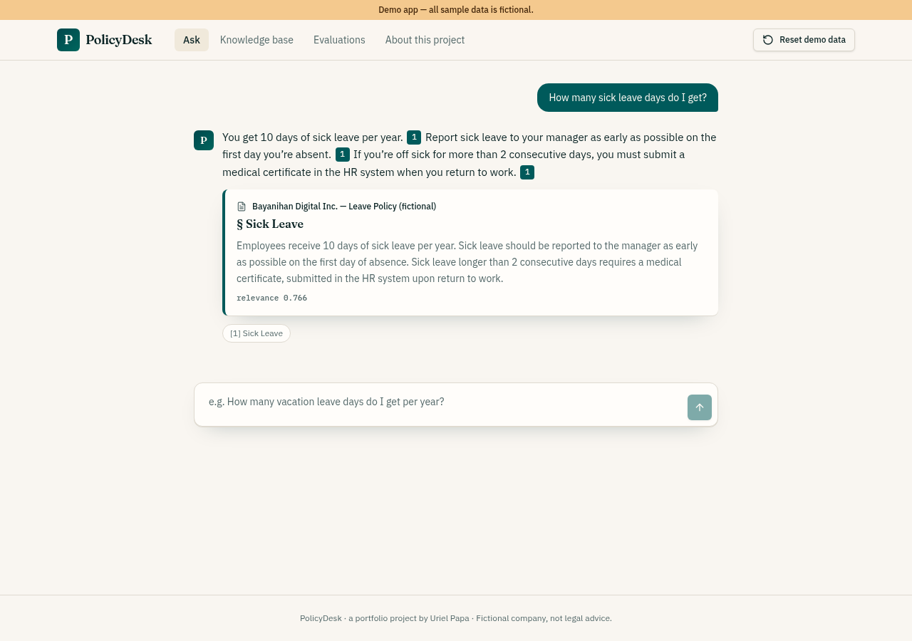
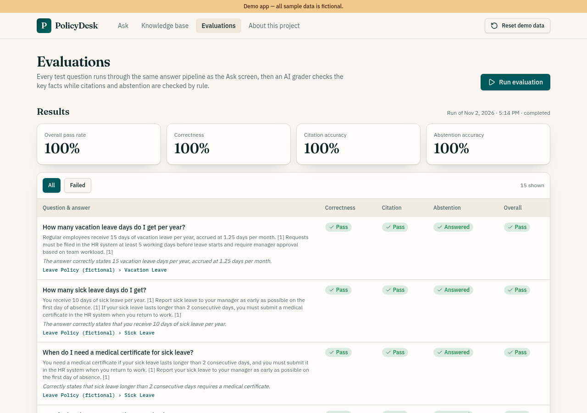
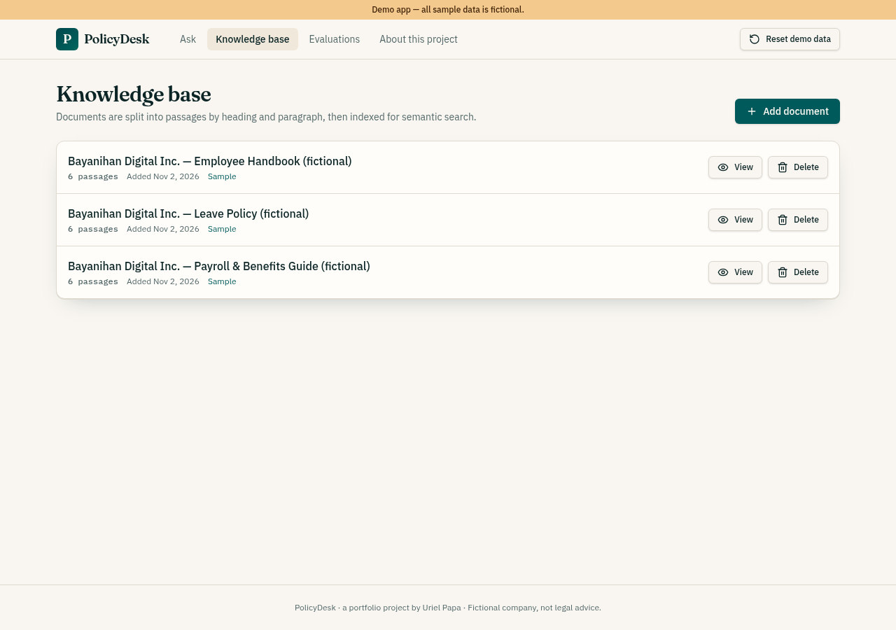
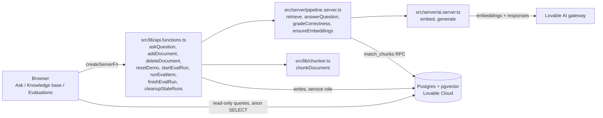

# PolicyDesk

An HR and payroll policy assistant that answers only from company documents, cites every passage it uses, and measures its own accuracy.

**Live demo:** https://policydesk-uriel.lovable.app

Demo app. All sample data is fictional.



## The problem

Employees ask HR the same policy questions over and over: leave balances, payroll dates, overtime rules. HR staff spend time answering them, and a general chatbot can't be trusted to answer, because it may invent a policy that sounds right. A useful assistant has to show where each answer came from and say "I don't know" when the documents don't cover the question.

## What it does

- **Ask:** chat-style Q&A. Answers include citation markers like [1]. Clicking a marker opens the cited passage with its document title, section heading and relevance score. Four starter questions are shown.
- **Abstention:** if no passage is relevant enough, the reply is "I couldn't find this in the company documents. Please ask HR." with no citations.
- **Knowledge base:** list, view, add and delete documents. New documents can be pasted or uploaded as .txt/.md. They are split into passages that keep their section heading, then embedded.
- **Evaluations:** a 15-question test set, run through the same answer pipeline as Ask. It shows KPIs (overall, correctness, citation accuracy, abstention accuracy), a per-question table with an all/failed filter, live progress ("7 / 15") and a history of past runs.
- **Reset demo data:** restores the 3 sample documents and 15 test questions and removes added documents. Run history is kept.
- **About this project:** problem, approach, architecture and next steps.





## How it works

The pattern is retrieval-augmented generation with a refusal threshold:

1. The question is embedded with Lovable AI (`google/gemini-embedding-2`).
2. A pgvector cosine search (`match_chunks` SQL function) returns the top 4 passages.
3. Passages scoring below 0.70 are dropped. If none remain, the app abstains without calling the chat model.
4. Otherwise the remaining passages are numbered and sent to the chat model (`openai/gpt-6-astra`) with instructions to use only those passages, cite them by number, and use the exact refusal sentence if they don't contain the answer.
5. The server keeps only the passages the answer actually cited and returns them to the browser.

The Evaluations screen calls the same `answerQuestion` function, so its scores reflect real behaviour. An AI grader (`gradeCorrectness`, JSON schema output) checks correctness against the expected key facts. Citation and abstention checks are deterministic rules in `gradeResult` (`src/lib/policy.ts`).

Every AI call has a 45-second timeout. Rate limit (429), credit (402) and timeout (504) errors are shown to the user as messages, and the evaluation runner retries a failed item once.



The browser reads demo tables directly under row-level security that allows anonymous SELECT only. All writes and all model calls go through server functions, so the AI key and the privileged database client never reach the browser.

## Data model

| Table | What it holds |
|---|---|
| `documents` | Policy documents: title, full content, added date. |
| `chunks` | Passages of each document: section heading, text, and a 3072-dimension embedding (`vector(3072)`). |
| `test_cases` | Evaluation questions: expected key facts, expected source document, "should abstain" flag. |
| `eval_runs` | One row per evaluation run: status (`running`, `completed`, `incomplete`), totals and the four percentage scores. |
| `eval_results` | One row per question per run: answer, citations, pass/fail for each check and the grader's reason. |

Seed rows ship without embeddings. `ensureEmbeddings` fills in missing vectors before retrieval. Runs left in `running` for more than 15 minutes (for example, a closed tab) are marked `incomplete`, with scores computed from their saved results.

## Quality and testing

Results from browser QA of the published app:

- Seed knowledge base: 3 fictional policy documents (Employee Handbook, Leave Policy, Payroll & Benefits Guide), 18 passages.
- Evaluation set: 15 questions, 12 answerable and 3 that should be refused. The published app's evaluation run scored 100% on correctness, citation accuracy and abstention.
- "How many sick leave days do I get?" answered "10 days" with a clickable citation to the Leave Policy.
- "Can I bring my dog to the office?" was refused with no citations.
- A newly pasted Travel policy was cited for "PHP 1,500 per day". After the document was deleted, the same question was refused.
- A Chrome-specific crash was found in QA: a React effect returned the Promise from `scrollIntoView()`, and React called it as a cleanup function. It was fixed, and a regression test was added.

Automated tests (Vitest, `npm test`):

- `src/test/policy.test.ts`: grading rules for citation and abstention, percentage rounding, seed data (15 tests, 3 should-abstain), and the chunker keeping headings and passages under 800 characters.
- `src/test/app-routing.test.tsx`: the `/` route resolves to the Ask page instead of "not found".
- `src/test/ask-effect-cleanup.test.tsx`: the Ask page renders answers and survives a second question when `scrollIntoView` returns a Promise (the regression test for the crash above).

## Tech stack

- **Frontend:** React 19, TanStack Router, TanStack Query, Tailwind CSS v4, Radix UI / shadcn components, lucide-react icons.
- **Server:** TanStack Start server functions (`createServerFn`), built with Vite.
- **Database:** Postgres with pgvector on Lovable Cloud, accessed with `@supabase/supabase-js`. Row-level security on every table.
- **AI:** Lovable AI gateway: `google/gemini-embedding-2` for embeddings, `openai/gpt-6-astra` for answers and grading.
- **Hosting:** Lovable (edge runtime).
- **Tests:** Vitest and Testing Library.

## Run locally

Prerequisites: Node 22.

```sh
npm i
npm run dev
```

Environment variables (names only):

- `SUPABASE_URL`, `SUPABASE_PUBLISHABLE_KEY`, `SUPABASE_PROJECT_ID`
- `VITE_SUPABASE_URL`, `VITE_SUPABASE_PUBLISHABLE_KEY`, `VITE_SUPABASE_PROJECT_ID`
- `LOVABLE_API_KEY` and the database service role key are server-side secrets provided by Lovable Cloud.

Note: AI calls use the Lovable AI gateway, which only works with Lovable Cloud. To run elsewhere, replace the calls in `src/server/ai.server.ts` with your own model provider key.

## Limitations and next steps

- Public demo with no login. A real deployment would add single sign-on, per-employee access, and audit logs of questions and answers.
- Anyone can add, delete or reset documents in the demo. A real deployment would limit document management to HR admins and keep version history.
- The 0.70 relevance threshold was tuned on this small sample set. It would need re-tuning against a larger set of real employee questions.
- The evaluation set has 15 questions. A real deployment would grow it from real questions and run it automatically whenever documents or prompts change.
- Answers depend on the documents being current. A real deployment would sync from the HR system or document store instead of manual pasting.

## Author

Uriel Papa: [GitHub](https://github.com/Edamuza) · [LinkedIn](https://www.linkedin.com/in/uriel-papa-vitese01/)

Built with Lovable (AI app builder) from a written spec, then tested against acceptance checks and fixed.
